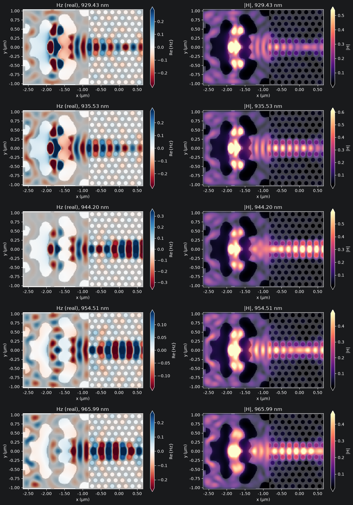

# Hi, I'm Radheya

I'm a Ph.D. student in Quantum Science and Engineering at the University of Delaware. I design tiny photonic devices that help us work with light, one photon at a time. My research focuses on making it easier to generate, guide, and collect photons from erbium ions embedded in gallium arsenide, with quantum networks as the longer-term goal.

I enjoy taking a device from an idea to a simulated design, then working with fabrication and measurement teams to understand what it takes to make it work in practice. Much of my work uses inverse design: we tell an optimization routine what we want light to do, and it helps find a structure that can do it.

## Projects

### Grating couplers: getting light off the chip

Light in a waveguide travels along the chip, but our measurement equipment needs a way to collect it. A grating coupler redirects that light out of the plane of the chip. For our single-photon devices, this lets us collect the emitted photons and study their properties, including whether the source emits one photon at a time.

I designed GaAs grating couplers that reached **40% coupling efficiency in simulation, compared with 13% for the conventional design**—roughly three times as efficient. The optimization included limits on how small the features could be, so the designs accounted for fabrication from the start. I also checked how performance changed with wavelength and etch depth to understand how sensitive the couplers were to fabrication variations.

### Nanobeam cavities: keeping light close to an emitter

Getting an emitter to interact strongly with light is easier when the light stays close by. A nanobeam cavity confines light to a small region, giving an embedded emitter more opportunity to interact with it. The aim is to help direct emission into a useful optical mode, so more of those photons can eventually be collected.

I design photonic-crystal nanobeam cavities for erbium-based devices at telecom wavelengths. In simulation, the designs reached **quality factors of one million to ten million**, a measure of how long the cavity can hold light, while keeping it confined to a very small space. I build fabrication limits into the optimization and work with nanofabrication researchers to keep the designs practical.

### Mode converters: helping photons reach the output

Photons emitted inside a photonic-crystal waveguide need a way to reach the grating coupler, where we can collect them for measurement. Along the way, the light has to pass into a nanobeam waveguide. The two waveguides carry light in different spatial patterns, so the connection needs to account for that difference to avoid losing photons.

I start by choosing an index-guided band in the W1 photonic-crystal waveguide that covers our target wavelengths. Using MIT Photonic Bands, I calculate the light's field pattern—the Bloch mode—at several points along that part of the band. I then normalize each profile and use it as a target in Tidy3D to optimize a separate coupler for that k point and its corresponding wavelength.

Each design is tailored to the mode at its chosen wavelength. The goal is to help photons from quantum emitters move between the photonic-crystal and nanobeam waveguides, then reach the grating coupler for collection.

*Each row shows a separate coupler optimized for one k/wavelength point. The left column shows the real part of Hz, and the right shows the magnetic-field magnitude. These are individual designs, rather than a wavelength sweep of one broadband coupler.*

### Checking how closely fabricated devices match the design

A good simulation is only part of the story. Once a device is fabricated, we need to know how closely its shape matches the original layout. Small differences can affect how light behaves, especially in structures with very fine features.

I developed a Python workflow that aligns scanning electron microscope images with the design files and compares their shapes automatically. The analysis found **97.5% agreement across full images and 93.3% in selected regions**, using an overlap-based metric. This gives the fabrication team a repeatable way to measure how well the pattern transfers from a design to a real device. I am the second author on the resulting manuscript.

### Understanding the emitters we design around

A cavity needs to work at the wavelengths where the emitters actually produce light. I analyzed photoluminescence data from erbium-doped GaAs samples supplied by our growth and spectroscopy collaborators to understand how widely the emission frequencies were spread.

That information helps set targets for the cavity design and estimate which emitters a cavity could interact with. Alongside this, I model how the emitter, cavity, and waveguide work together, with the practical goal of getting more emitted photons into a useful output.

### Muon detection during solar events

I also enjoy projects that connect a physical measurement with a data question. For this project, I built a muon detector with guidance from Dr. Axani and explored how its measurements related to extreme solar activity.

The data showed a **4% increase in muon rates during events with high proton flux**. I proposed an analysis framework to study that relationship further.

## Experience

### Photonics research · University of Delaware

Since December 2023, I have worked on photonic inverse design, device simulation, and the connection between design and fabrication. My projects bring together optical modeling, Python automation, and collaboration with materials growth, spectroscopy, and nanofabrication teams.

### DevOps Engineer · Birlasoft

*September 2021 – June 2023 · Consultant to Synchrony Bank*

Before moving into quantum research, I worked on production banking systems. I carried out more than 50 software deployments and helped manage over 200 production and non-production servers. The work involved coordinating development, database, and client teams, as well as planning Linux patching and maintenance. It taught me to approach technical work with reliability and clear communication in mind.

## Tools I work with

- **Design and simulation:** Tidy3D, SPINS-B, Maxwell-B, Legume, and MIT Photonic Bands.
- **Programming and analysis:** Python, NumPy, SciPy, Pandas, and C/C++.
- **Layout and fabrication analysis:** KLayout, GDSII layouts, and scanning electron microscope image analysis.

## Education

- **Ph.D., Quantum Science and Engineering** · University of Delaware · June 2025–present
- **M.S., Quantum Science and Engineering** · University of Delaware · August 2023–May 2025
- **B.E., Computer Engineering** · University of Pune · July 2017–July 2021

## Research writing

L. H. Mai, R. S. Sarode, et al., “Versatile Sleeve-and-Bulk Fabrication of Inversely Designed Nanophotonic Structures with High Pattern Transfer Fidelity.” Submitted to *IEEE Journal of Selected Topics in Quantum Electronics*, June 2026. Preprint: arXiv:2609.13460.

## Talks, posters, and learning

- Research talks at the University of Virginia: Physics Seminar and Materials Science class, September 2026.
- Poster on fabrication-robust inverse-designed couplers at Bryn Mawr Quantum Day, September 2025.
- Poster on inverse-design nanophotonics at the PhotonicsNJ Member Event, July 2025.
- Single Photon Short Course at CU Boulder, August 2025; C2QA Quantum Error Mitigation program, August 2024; Caltech Quantum Engineering Workshop, May 2024.
